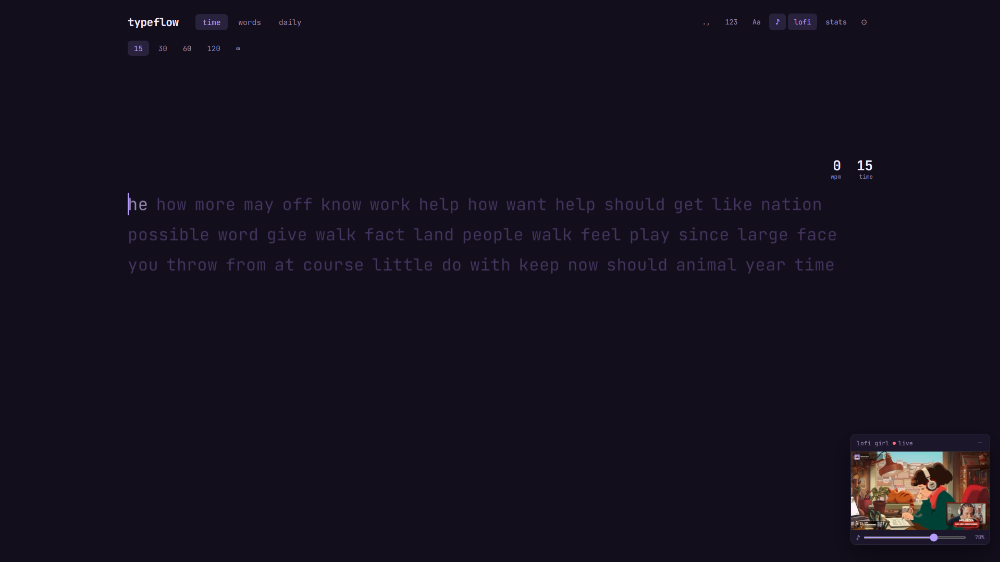

# TypeFlow

A typing test based on MonkeyType with keyboard sounds and lofi.

**Live site:** https://type-flow-daily.vercel.app

## Features

- Time, words and daily test modes, with optional punctuation and numbers
- Color themes
- Five mechanical keyboard sound packs
- Adjustable text size
- Live stats and personal bests, including custom configurations
- Embedded Lofi Girl live stream

## Tech Stack

- [Vite](https://vite.dev/)
- HTML, CSS and vanilla JavaScript
- Keyboard sounds from [KBSIM](public/sounds/KBSIM-LICENSE.md)
- Hosted on [Vercel](https://vercel.com)
